  

    

  

    

  

    
    
    
  

---

### `// PROFILE_SPEC`

<pre lang="yaml"><code>handle: nome
system: Nome AI
role: Machine Learning Engineer // AI Researcher // Backend Developer
domains:
  ml_research:
    - Deep Learning &amp; NLP (PyTorch, Transformers, Custom Architectures)
    - Tabular &amp; Classical ML (LightGBM, Gradient Boosting, Feature Engineering)
    - Out-of-Fold Cross-Validation, Metric Optimization, Ensembling
  backend_engineering:
    - High-Load Services &amp; API Design (Python / FastAPI, Java / Spring Boot)
    - Distributed Data Stores &amp; Caching (PostgreSQL, Redis)
    - Self-Hosted Infrastructure, Reverse Proxies, Containerization</code></pre>

---

### `// TECH_STACK`

#### `[ MACHINE LEARNING & RESEARCH ]`

  
  
  
  
  
  

#### `[ BACKEND & CORE LANGUAGES ]`

  
  
  
  
  
  

#### `[ INFRASTRUCTURE & OPS ]`

  
  
  
  

---

### `// TELEMETRY & METRICS`

  
  

   
  

